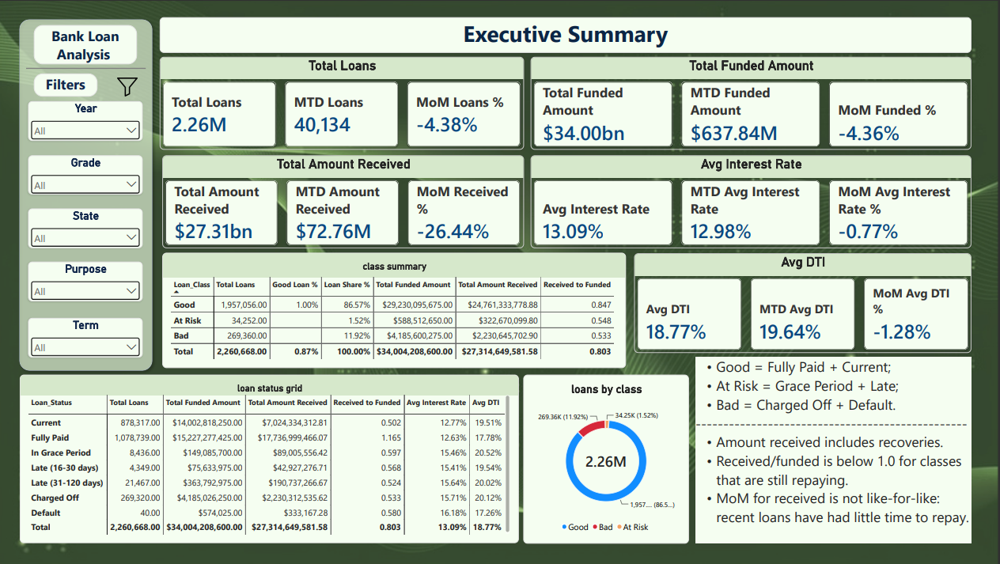
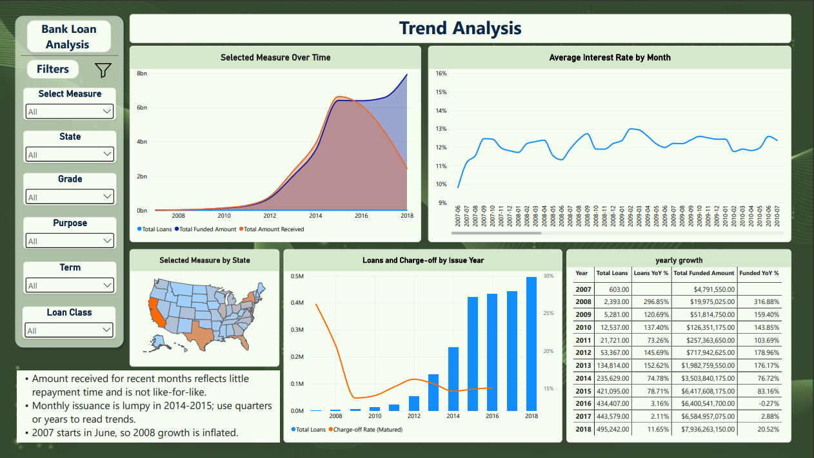
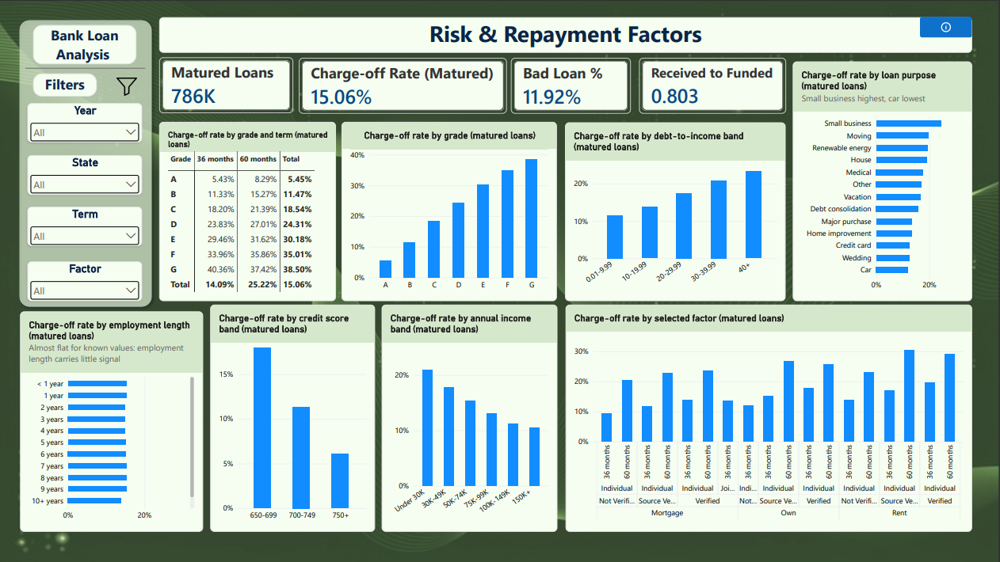
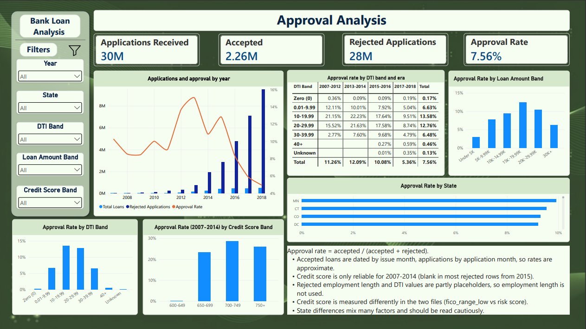
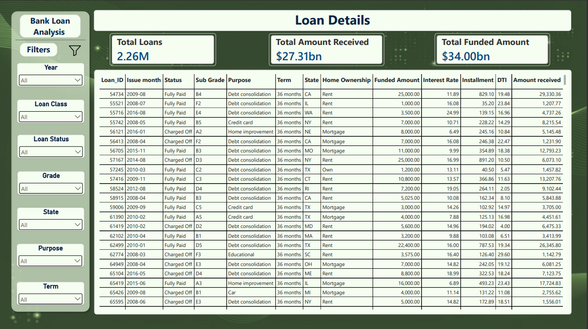

# Syntecxhub Bank Loan Analysis

An end-to-end lending analytics project built with **SQL Server (T-SQL, SSMS), Power Query, DAX, and Power BI**, using LendingClub's public loan data (2007-2018): **2,260,668 funded loans** and **27,648,741 rejected applications**.

Rather than loading a CSV straight into Power BI, the project follows a professional analytics pipeline: the raw files are staged as text in SQL Server, validated, cleaned through documented business rules, transformed into a star-schema model, validated again with 48 automated checks, and only then analysed in a five-page interactive Power BI dashboard. **All cleaning, modification, and validation happens in SQL Server before Power BI.**

> **Repository note: two things are deliberately not in this repository**
>
> | Not included | Why | What to use instead |
> |---|---|---|
> | `Raw_Data/` (about 3.2 GB) | Far beyond GitHub's file size limits | Download link and extraction steps in [How to Reproduce This Project](#how-to-reproduce-this-project) |
> | `PowerBI/*.pbix` | Too large to commit (the model holds 2.26M loan rows) | The model is fully documented in this README ([Data Model](#data-model), [Rebuilding the Power BI Report](#rebuilding-the-power-bi-report)) and in [`PowerBI/DAX_Measures.md`](PowerBI/DAX_Measures.md). Dashboard images and a PDF export are included. |
>
> Everything needed to rebuild the report from scratch is written down here: the 15 imported tables, the 19 relationships, the Power Query steps, every DAX measure, and every visual with its fields.

---

## Table of Contents

1. [Project Overview](#project-overview)
2. [Project Requirements and How They Were Met](#project-requirements-and-how-they-were-met)
3. [Dataset and Data Source](#dataset-and-data-source)
4. [Pipeline Architecture](#pipeline-architecture)
5. [Complete Project Workflow](#complete-project-workflow)
6. [Data Quality Findings and Decisions](#data-quality-findings-and-decisions)
7. [Business Rules](#business-rules)
8. [Data Model](#data-model)
9. [KPIs and DAX Measures](#kpis-and-dax-measures)
10. [Power BI Dashboard Pages](#power-bi-dashboard-pages)
11. [Slicers and Interactivity](#slicers-and-interactivity)
12. [Testing and Validation](#testing-and-validation)
13. [Key Findings](#key-findings)
14. [Limitations and Notes](#limitations-and-notes)
15. [Tools and Technologies](#tools-and-technologies)
16. [Project Folder Structure](#project-folder-structure)
17. [How to Reproduce This Project](#how-to-reproduce-this-project)
18. [Rebuilding the Power BI Report](#rebuilding-the-power-bi-report)
19. [Author](#author)
20. [Project Status](#project-status)

---

## Project Overview

This project analyses a consumer lending portfolio: who borrowed, how much was funded, how much came back, which loans went bad, and which application and borrower characteristics are associated with approval and with repayment. It was completed as a Syntecxhub data analytics project.

The workflow was carried out in a structured sequence:

1. Raw data collection and file inspection
2. SQL Server database setup and text staging (30 million rows)
3. Basic staging validation against the source files
4. Detailed data-quality checks, each with a keep / fix / flag / exclude decision
5. Business rules (good, at-risk, and bad loans, maturity, bands)
6. Clean dimension tables
7. Date dimension
8. Fact tables (accepted loans, rejected applications) with a monthly aggregate
9. Analytical queries (the SQL answer key)
10. Clean model validation (48 automated checks)
11. Power BI import (Import mode), Power Query, relationships, and date table
12. DAX measures
13. Interactive dashboard (5 pages)
14. Dashboard testing against the SQL answer key
15. PDF and image export
16. GitHub documentation

The final Power BI report has five pages:

| # | Page | Purpose |
|---|------|---------|
| 1 | **Executive Summary** | Headline KPIs, month-to-date and month-on-month change, good / at-risk / bad loan split, loan status grid |
| 2 | **Trends** | Lending over time and by state, yearly growth, charge-off by issue year |
| 3 | **Risk & Repayment Factors** | Which borrower and loan characteristics are associated with charge-off |
| 4 | **Approval Analysis** | Accepted vs 27.6M rejected applications: which application characteristics are associated with approval |
| 5 | **Loan Details** | Loan-level grid for drill-down and export |

---

## Project Requirements and How They Were Met

| Requirement | How it was implemented |
|---|---|
| Analyze bank loan data (applications, funded amount, repayments) | 2,260,668 loans in `fact.Loans` (funded amount, total payment, installment, status, borrower attributes) plus 27,648,741 rejected applications in `fact.Rejected_Applications`. Page 1 and Page 5. |
| Calculate KPIs such as total applications, funded and received amounts | Total Loans, Total Funded Amount, Total Amount Received, Average Interest Rate and Average DTI, each with month-to-date, previous month-to-date and month-on-month change (Page 1) |
| Classify loans into good vs bad loans | Explicit three-class rule stored in `ref.Loan_Status_Map`: Good, At Risk, Bad. The two-class rule in common tutorials leaves about 1.5% of loans unclassified (see [Business Rules](#business-rules)). |
| Perform trend analysis by time, region and customers | Time: monthly, yearly and vintage trends (Page 2). Region: state map and state approval (Pages 2 and 4). Customers: DTI, income, employment length, home ownership, verification, credit score (Pages 3 and 4). |
| Identify factors affecting approval and repayment | Approval: accepted vs rejected by DTI, requested amount, credit score and era (Page 4). Repayment: matured-loan charge-off rate by 11 factors, with the maturity problem handled explicitly (Page 3). |
| Build a Power BI dashboard for insights | 5 pages, 2 field-parameter selectors (measure and factor), synchronized slicers, cross-filtering, drill-down, tooltips that show sample sizes |

---

## Dataset and Data Source

**Dataset:** Lending Club loan data, accepted and rejected loan applications, 2007 to 2018 Q4

**Source:** Kaggle, `wordsforthewise/lending-club` - https://www.kaggle.com/wordsforthewise/lending-club

**Files used:** `accepted_2007_to_2018Q4.csv` (1.56 GB) and `rejected_2007_to_2018Q4.csv` (1.66 GB), downloaded as `.csv.gz` and extracted.

### Why this source, and what to know about it

- **Real lending data, at scale:** It covers more than 2 million funded loans and nearly 28 million rejected applications, which makes it suitable for approval and repayment analysis. Its columns (grade, DTI, interest rate, loan status, total payment) match the fields lenders actually use.
- **Both sides of the decision:** The accepted file alone cannot answer "what affects approval", because it only contains approved loans. The rejected file supplies the other half.
- **It is a third-party redistribution:** The data is LendingClub's public release as re-uploaded on Kaggle. Check the dataset page for its current licence and terms before reusing it.
- **Privacy:** The columns used contain no names. Free-text fields (employment title, loan description and title) and the URL were deliberately not carried into the clean model.
- **Messy by design:** Profiling found placeholder values, mixed units, scientific-notation noise and 33 non-loan rows hidden inside the file. That made a documented validation pipeline necessary (see [Data Quality Findings and Decisions](#data-quality-findings-and-decisions)).

### Dataset structure

| Property | Accepted file | Rejected file |
|---|---|---|
| Data rows | 2,260,701, of which **33 are not loans** (footer and marker lines) | 27,648,741 |
| Real records | **2,260,668 loans** | 27,648,741 applications |
| Columns | 151 | 9 |
| Date range | Loans issued June 2007 to December 2018 | Applications 2007-05-26 to 2018-12-31 |
| Latest payment date (snapshot) | 2019-03-01 | not applicable |
| Total funded | $34,004,208,600 | not applicable |
| States | 51 (50 states plus DC) | 51, plus 22 rows with no state |

### Columns carried into the clean model

| Group | Columns |
|---|---|
| Loan identity and amounts | `id`, `loan_amnt`, `funded_amnt`, `installment`, `int_rate`, `term` |
| Outcome and repayment | `loan_status`, `total_pymnt`, `total_rec_prncp`, `total_rec_int`, `total_rec_late_fee`, `recoveries`, `out_prncp`, `last_pymnt_d`, `last_pymnt_amnt` |
| Borrower | `grade`, `sub_grade`, `emp_length`, `home_ownership`, `annual_inc`, `verification_status`, `purpose`, `addr_state`, `dti`, `application_type`, `fico_range_low/high`, `delinq_2yrs`, `inq_last_6mths`, `open_acc`, `pub_rec`, `revol_bal`, `revol_util`, `earliest_cr_line` |
| Time | `issue_d` |
| Rejected applications | amount requested, application date, risk score, debt-to-income ratio, state, employment length |

Columns left out: `member_id` (100% blank), the hardship, settlement, joint-application and secondary-applicant groups (94 to 99.6% blank), `desc`, `url`, `emp_title`, `title`, `zip_code`.

---

## Pipeline Architecture

```
Raw files (LendingClub accepted + rejected CSV, 3.2 GB, never modified)
        |
        v
SQL Server staging (all text)    -> stg.Accepted_Raw, stg.Rejected_Raw
        |
        v
Basic validation + data-quality checks (nothing modified; every finding gets a decision)
        |
        v
Business rules (ref schema)      -> loan class map, bands, config (snapshot date, thresholds)
        |
        v
Clean dimensions                 -> dim.Loan_Status, Grade, Purpose, Home_Ownership, Term,
                                    Verification_Status, Application_Type, Employment_Length,
                                    Geography, Date
Fact tables                      -> fact.Loans (2,260,668)
                                    fact.Rejected_Applications (27,648,741)
                                    fact.Rejected_Monthly (778,276, aggregate for Power BI)
        |
        v
Analytical queries (the answer key) + 48-check validation gate
        |
        v
Power BI (Import mode, 15 tables) -> Power Query -> star schema -> DAX -> 5-page dashboard
        |
        v
Testing against SQL results -> PDF + PNG export -> GitHub
```

Key principles:

- **The staging tables are never modified.** All cleaning happens by creating new tables from them, so every transformation is traceable and reproducible.
- **Every finding is logged with a decision and a reason** in [`SQL/staging_quality_notes.md`](SQL/staging_quality_notes.md).
- **Staging is all text on purpose.** A single bad value makes a typed load fail. Text always loads, and type conversion happens later in SQL, where failures can be counted.

---

## Complete Project Workflow

### Step 1: Raw data collection and inspection

Files were extracted and their facts recorded before any loading: header rows, line counts (2,260,702 and 27,648,742 including headers), file sizes, and the last lines of the accepted file. 

That showed the accepted file ends with non-loan lines and set the baseline row counts used in every later reconciliation.

### Step 2: Database setup and staging (`SQL/01_database_setup.sql`)

- Created the database `Syntecxhub_Bank_Loan_Analysis` (SIMPLE recovery model, to keep the log small during 30 million-row loads), with schemas `stg`, `dim`, `fact` (and later `ref`, `audit`)
- Created two all-text staging tables. The accepted table's 151 columns were generated from the file header with a short PowerShell script instead of typed by hand.
- Loaded both files with `BULK INSERT` (`FORMAT = 'CSV'`). The files have Unix line endings, so `ROWTERMINATOR = '0x0a'`.
- A rejected-file load error on free-text loan titles led to widening that column to `NVARCHAR(MAX)`.

### Step 3: Basic staging validation (`SQL/02_staging_basic_validation.sql`)

- Staged row counts equal the file line counts minus the header, for both tables
- Column counts (151 and 9) and CR-contamination (0 rows)
- Found **33 non-loan rows** inside the accepted file (yearly footer lines "Total amount funded in policy code N" and one section marker)
- The policy-1 footer totals sum to **34,004,208,600**, equal to the sum of funded amounts of the 2,260,668 loan rows, which proves the load is complete to the dollar
- Blank profile of all 151 columns, category lists, date and numeric parse tests, loan id uniqueness, database size

### Step 4: Data-quality checks (`SQL/03_staging_data_quality_checks.sql`, `SQL/staging_quality_notes.md`)

Detailed checks on duplicates, invalid values, date logic, category consistency, status vs payment behaviour, vintage maturity and the rejected file. See [Data Quality Findings and Decisions](#data-quality-findings-and-decisions).

### Step 5: Business rules (`SQL/04_business_rules.sql`)

Rule tables in the `ref` schema: loan status map, DTI / income / loan-amount / risk-score bands, and a config table (snapshot date 2019-03-01, outlier and placeholder thresholds). See [Business Rules](#business-rules).

### Step 6: Clean dimensions (`SQL/05_create_clean_dimensions.sql`)

Nine dimensions, each with a surrogate key, a unique constraint on the business value and trimmed text. Coverage checks confirmed zero unmatched values in both source tables.

| Table | Rows | Notes |
|---|---|---|
| `dim.Loan_Status` | 7 | Built from the status map; carries class, sort order, resolved and charged-off flags |
| `dim.Grade` | 35 | Sub-grade grain with grade as parent level |
| `dim.Purpose` | 14 | |
| `dim.Home_Ownership` | 4 | ANY, OTHER and NONE (1,232 loans) merged into Other |
| `dim.Term` | 2 | 36 and 60 months |
| `dim.Verification_Status` | 3 | |
| `dim.Application_Type` | 2 | |
| `dim.Employment_Length` | 12 | Blank becomes an explicit Unknown member, with a sort key |
| `dim.Geography` | 52 | 50 states, DC and Unknown |

### Step 7: Date dimension (`SQL/06_create_date_dimension.sql`)

`dim.Date` is one shared calendar for both fact tables: 4,748 daily rows from 2007-01-01 to 2019-12-31, generated with a recursive CTE. Accepted loans only carry an issue month, so they attach to the first day of that month. Rejected applications attach to their exact day.

### Step 8: Fact tables (`SQL/07a_create_fact_loans.sql`, `SQL/07b_create_fact_rejected.sql`)

Each fact table is built from a source view that performs all lookups and conversions. The view is checked for missing keys **before** the load, and 25 foreign keys are created `WITH CHECK` after it.

`fact.Loans` (one row per loan, 2,260,668 rows): keys to every dimension and band, money columns converted with `ROUND(TRY_CAST(col AS FLOAT), 2)` (this fixes scientific-notation noise that silently turned 108 values into NULLs), cleaned income and DTI, and the flags `Is_Matured`, `Is_Income_Outlier`, `Is_Possible_Duplicate`.

`fact.Rejected_Applications` (27,648,741 rows, page-compressed, loaded one application year at a time): cleaned amount, DTI and risk score with band keys.

`fact.Rejected_Monthly` (778,276 rows): aggregate by month, state, DTI band, loan-amount band and risk band. Power BI cannot comfortably import 27.6M rows, and the aggregate shares its grain and dimensions with `fact.Loans`, so approval rate becomes a simple ratio.

### Step 9: Analytical queries (`SQL/08_analytical_queries.sql`, `SQL/08b_dti_zero_band.sql`, `SQL/10_dashboard_expected_values.sql`)

The SQL equivalent of a query document: every KPI, trend, factor profile and approval breakdown, built on the fact tables. `audit.Factor_Profile` gives volume, money and matured charge-off for all levels of 12 factors in one pass. These results are the answer key the dashboard was tested against.

Query 08b isolated rejected applications with a DTI of exactly 0 into their own band after the analysis showed they behave differently from low-DTI applications (see [Key Findings](#key-findings)).

### Step 10: Clean model validation (`SQL/09_validate_clean_model.sql`)

48 automated checks stored in `audit.Validation_Results` (see [Testing and Validation](#testing-and-validation)). Results exported to `SQL/validation_results.csv`.

### Steps 11-13: Power BI import, model, measures and dashboard

See [Data Model](#data-model), [KPIs and DAX Measures](#kpis-and-dax-measures), [Power BI Dashboard Pages](#power-bi-dashboard-pages) and [Rebuilding the Power BI Report](#rebuilding-the-power-bi-report).

---

## Data Quality Findings and Decisions

Every finding was counted, then given a decision. The full log (about 100 entries) is in [`SQL/staging_quality_notes.md`](SQL/staging_quality_notes.md). The decisions that shape the results:

| Area | Finding | Decision and reason |
|---|---|---|
| Non-loan rows | 33 rows in the accepted file are footers or markers, scattered between yearly sections | A valid loan is a row with a numeric id. 2,260,668 loans remain, and their funded total equals the file's own footer total. |
| Dead columns | `member_id` 100% blank; hardship, settlement, joint and secondary-applicant groups 94-99.6% blank | Excluded from the clean model: no analytical value |
| Units | `int_rate`, `dti`, `revol_util` are percentages (10.49), not fractions | Kept as percent and documented; never multiplied by 100 |
| Scientific notation | 108 loans had `total_rec_late_fee` like `-2e-10` | Convert money through `FLOAT` then round to cents. `total_pymnt` itself was unaffected, so the received KPI was never wrong. |
| Income | 1,667 zeros, 583 above $1M (max $110M, with a matching tiny DTI) | Zero becomes NULL ("not reported"). Large values are kept and flagged. Income is only analysed in bands, never averaged. |
| DTI (accepted) | 1,711 blank, 2 negative, 135 at 999 | Set to NULL (placeholders). 2,426 loans between 100 and 998 are kept as plausible. |
| Statuses | 9 values, including 2 legacy "does not meet the credit policy" labels | Explicit three-class rule (below); legacy labels fold into Fully Paid / Charged Off |
| Vintage maturity | Charge-off rate by issue year: 15.6-18.0% (2013-15), 8.8% (2017), 1.8% (2018) | Recent loans have had no time to default. Risk is measured on matured loans only. |
| Duplicates | 1 pair of loans identical on 10 attributes, different ids | Both kept and flagged (2 of 2.26M rows) |
| Rejected amount | 1,288 requests of $0 | Set to NULL |
| Rejected DTI | 1,203,063 values of -1%; 169,258 at 999 or above; max 50,000,031% | NULL if below 0 or 999 and above. 100-998 kept. |
| Rejected DTI = 100 | 1,362,556 rows (0.7% of 2016, 5.4% of 2017, 10.0% of 2018, about 0% before 2014) | Kept, but rejected DTI is only used through bands, never averaged |
| Rejected DTI = 0 | 1,045,102 rejected rows vs 1,732 accepted loans | Isolated in a "Zero (0)" band (0.17% approval) |
| Rejected risk score | Range 0-990; blank in 82%, 79%, 46% and 93% of 2015-2018 rows | Valid range 300-850, else NULL. Used for application years 2007-2014 only. |
| Rejected employment length | "< 1 year" in 73-91% of rows in most years vs 8% of accepted loans | A placeholder-like value, so employment length is not used for approval analysis |
| Rejected state | 22 rows with no state | Kept as an Unknown member |

---

## Business Rules

These are stored in tables, so SQL, the dashboard and this document use one definition.

| Rule | Definition | Why |
|---|---|---|
| **Good loan** | Fully Paid, Current | Repaid, or repaying on schedule |
| **At Risk loan** | In Grace Period, Late (16-30 days), Late (31-120 days) | Delinquent; outcome unknown. Kept separate so it is not forced into good or bad. |
| **Bad loan** | Charged Off, Default | Written off, or more than 120 days late |
| Class split | Good 1,957,056 (86.57%), At Risk 34,252 (1.52%), Bad 269,360 (11.92%) | Every one of the 2,260,668 loans is classified |
| **Matured loan** | Issue month + term is on or before the snapshot date 2019-03-01 | Only matured loans have had their full chance to default |
| **Charge-off rate (primary risk measure)** | Matured charged-off loans / matured loans, shown only when there are at least 500 matured loans | Comparable across vintages. 2017-2018 have no matured loans and show blank ("not matured yet"), never 0%. |
| Amount received | `total_pymnt`, which includes recoveries | It equals principal + interest + late fees + recoveries for every loan |
| Received to funded | Amount received / funded amount | Below 1.0 for loans still repaying, so it is read per loan class or status, not as a verdict |
| DTI bands | Zero (0); 0.01-9.99; 10-19.99; 20-29.99; 30-39.99; 40+; Unknown (blank, negative or 999 and above) | Placeholders get their own band instead of distorting averages |
| Income bands | Under 30K; 30K-49K; 50K-74K; 75K-99K; 100K-149K; 150K+; Unknown | Neutralizes extreme incomes |
| Loan amount bands | Under 5K; 5K-9.99K; 10K-14.99K; 15K-19.99K; 20K-29.99K; 30K+; Unknown | Requested amount, the only amount present in both files |
| Credit score bands | Under 600; 600-649; 650-699; 700-749; 750+; Unknown | Accepted side uses `fico_range_low`, rejected side uses the risk score |
| **Approval rate** | Accepted / (accepted + rejected) | Computed on shared dimensions only |

---

## Data Model

The model is a **star schema with two fact tables** that share five dimensions. Power BI imports **15 tables** in Import mode.

| Table | Rows in Power BI | Role |
|---|---|---|
| `fact_Loans` | 2,260,668 | One row per funded loan |
| `fact_Rejected_Monthly` | 778,276 | Rejected applications aggregated by month, state, DTI band, amount band and risk band |
| `dim_Date` | 4,263 | Calendar, trimmed to 2007-05-01 .. 2018-12-31 in Power Query (see below) |
| `dim_Loan_Status` | 7 | |
| `dim_Grade` | 35 | |
| `dim_Purpose` | 14 | |
| `dim_Home_Ownership` | 4 | |
| `dim_Term` | 2 | |
| `dim_Verification_Status` | 3 | |
| `dim_Application_Type` | 2 | |
| `dim_Employment_Length` | 12 | |
| `dim_Geography` | 52 | |
| `dim_DTI_Band` | 7 | |
| `dim_Income_Band` | 7 | |
| `dim_Loan_Amount_Band` | 7 | |
| `dim_Risk_Band` | 6 | |

**Deliberately not imported:** the `stg` and `audit` schemas, `ref.Config`, the two mapping tables, and `fact.Rejected_Applications` (27.6M rows, kept in SQL as the audit trail).

### Relationships (19, all one-to-many, single direction, active; the dimension is the "one" side)

| From (one) | To (many) |
|---|---|
| `dim_Date[Date_Key]` | `fact_Loans[Issue_Date_Key]` |
| `dim_Date[Date_Key]` | `fact_Rejected_Monthly[Month_Date_Key]` |
| `dim_Loan_Status[Loan_Status_Key]` | `fact_Loans[Loan_Status_Key]` |
| `dim_Grade[Grade_Key]` | `fact_Loans[Grade_Key]` |
| `dim_Purpose[Purpose_Key]` | `fact_Loans[Purpose_Key]` |
| `dim_Home_Ownership[Home_Ownership_Key]` | `fact_Loans[Home_Ownership_Key]` |
| `dim_Term[Term_Key]` | `fact_Loans[Term_Key]` |
| `dim_Verification_Status[Verification_Key]` | `fact_Loans[Verification_Key]` |
| `dim_Application_Type[Application_Type_Key]` | `fact_Loans[Application_Type_Key]` |
| `dim_Employment_Length[Emp_Length_Key]` | `fact_Loans[Emp_Length_Key]` |
| `dim_Geography[Geography_Key]` | `fact_Loans[Geography_Key]` |
| `dim_Geography[Geography_Key]` | `fact_Rejected_Monthly[Geography_Key]` |
| `dim_DTI_Band[DTI_Band_Key]` | `fact_Loans[DTI_Band_Key]` |
| `dim_DTI_Band[DTI_Band_Key]` | `fact_Rejected_Monthly[DTI_Band_Key]` |
| `dim_Income_Band[Income_Band_Key]` | `fact_Loans[Income_Band_Key]` |
| `dim_Loan_Amount_Band[Loan_Amount_Band_Key]` | `fact_Loans[Loan_Amount_Band_Key]` |
| `dim_Loan_Amount_Band[Loan_Amount_Band_Key]` | `fact_Rejected_Monthly[Loan_Amount_Band_Key]` |
| `dim_Risk_Band[Risk_Band_Key]` | `fact_Loans[Risk_Band_Key]` |
| `dim_Risk_Band[Risk_Band_Key]` | `fact_Rejected_Monthly[Risk_Band_Key]` |

Five dimensions are shared by both facts (Date, Geography, DTI band, Loan amount band, Risk band), so a single slicer filters loans and rejections together. The loan-only dimensions (grade, purpose, term, income band, home ownership, verification, application type, employment length, loan status) have **no** connection to the rejected table, because the rejected file does not contain those fields. The approval measures therefore return blank when such a filter is active, instead of dividing filtered loans by unfiltered rejections.

### Model settings

- `dim_Date` is **marked as the date table** using `Full_Date`; **Auto date/time is turned off**.
- `dim_Date` is trimmed in Power Query to 2007-05-01 .. 2018-12-31 (4,263 rows). Time-intelligence functions treat the last date in the table as "today", so a calendar that extends past the data would make every month-to-date card show 0.
- **Sort by column:**

| Column | Sorted by |
|---|---|
| `dim_Date[Month_Name]`, `[Month_Short]` | `Month_Number` |
| `dim_Date[Year_Month]` | `Month_Sort` |
| `dim_DTI_Band[DTI Band]` | `Sort_Order` (the Zero (0) band has key 7 but sorts first) |
| `dim_Income_Band[Income Band]` | `Income_Band_Key` |
| `dim_Loan_Amount_Band[Loan Amount Band]` | `Loan_Amount_Band_Key` |
| `dim_Risk_Band[Credit Score Band]` | `Risk_Band_Key` |
| `dim_Employment_Length[Emp_Length_Label]` | `Emp_Length_Sort` |
| `dim_Term[Term_Label]` | `Term_Months` |
| `dim_Loan_Status[Loan_Status]` | `Loan_Status_Key` |
| `dim_Loan_Status[Loan_Class]` | `Class_Sort` |

- **Summarization = Don't summarize:** `dim_Date[Year]`, `[Quarter]`, `[Month_Number]`, `[Day_Number]`, `[Week_Number]`, `fact_Loans[Loan_ID]`.
- **Calculated items:** `dim_Geography[Map_Location]` (state name plus ", United States", data category Place), `dim_Date[Era]` (2007-2012, 2013-2014, 2015-2016, 2017-2018), and the hierarchy `Date Hierarchy` = Year > Year_Quarter > Year_Month.
- **Hidden from report view:** every `*_Key` column, every sort column, band `Lower_Bound` and `Upper_Bound`, and the helper measure `Loan-Only Filter Active`.
- **Formats:** `Interest_Rate` and `DTI` columns and measures use the custom format `0.00"%"`, because the values are already percentages and the built-in Percentage format would multiply them by 100.

---

## KPIs and DAX Measures

All measures are listed in full in [`PowerBI/DAX_Measures.md`](PowerBI/DAX_Measures.md), together with formats, field parameters and a regression test. The main definitions:

| KPI | Definition | Why it matters |
|---|---|---|
| **Total Loans** | Count of funded loans | Lending volume |
| **Total Funded Amount** | Sum of funded amount | Money lent out |
| **Total Amount Received** | Sum of total payment (includes recoveries) | Money that came back |
| **Received to Funded** | Received / funded | Repayment progress. Below 1.0 while loans are still repaying. |
| **Avg Interest Rate / Avg DTI** | Average of the loan-level percentages | Pricing and borrower leverage |
| **MTD, PMTD, MoM %** | Latest month in the filter context, the month before it, and the relative change | Monthly momentum. For rate and DTI it is relative change, not percentage points. |
| **Loans YoY % / Funded YoY %** | Change vs the same period last year | Growth rate |
| **Good / At Risk / Bad Loans, %** | Loans by class, and share of all loans | Portfolio quality |
| **Matured Loans** | Loans whose term has ended by 2019-03-01 | Basis for fair risk comparison |
| **Charge-off Rate (Matured)** | Matured charged-off / matured; blank under 500 matured loans | The primary repayment risk measure |
| **Rejected Applications, Applications Received, Approval Rate** | Rejected count, accepted + rejected, accepted / received | Approval analysis. Blank under any loan-only filter. |
| **Approval Rate (2007-2014)** | Approval rate restricted to years where the rejected risk score is reliable | Credit-score analysis |

The matured-loan rule is the most important modelling decision. Without it, 2017 and 2018 look safe (charge-off 8.8% and 1.8%) only because their loans have not had time to fail.

---

## Power BI Dashboard Pages

Every page shares the same layout: a left panel with the page navigator, the slicers for that page and a "clear all slicers" button, a title banner, and visuals on pale panels. The report was built with the original dark-green theme, but any consistent theme works. The default visual interaction is **cross-filtering** (cross-highlighting misrepresents ratio measures such as charge-off rate).

Dashboard screenshots are in `Dashboard_Images/` and a PDF export is in `Exported_Reports/`. Figures quoted below come from the dashboard with no slicers applied.

---

### Page 1: Executive Summary

Answers: How large is the portfolio, and how is it performing?



**Slicers:** Year, Grade, State, Purpose, Term.

| Visual | Fields | What it shows |
|---|---|---|
| **KPI tiles (5)** | Each tile: the measure, its MTD version, and its MoM % version for Total Loans, Total Funded Amount, Total Amount Received, Avg Interest Rate, Avg DTI. Cards use display units (millions or billions) with 2 decimals. | 2.26M loans, $34.00bn funded, $27.31bn received, 13.09% average rate, 18.77% average DTI. MTD (December 2018): 40,134 loans, $637.84M funded, $72.76M received. MoM: -4.38%, -4.36%, -26.44%, -0.77%, -1.28%. |
| **Class summary** (matrix) | Rows `dim_Loan_Status[Loan_Class]` (sorted by `Class_Sort`); values: Total Loans, Loan Share %, Total Funded Amount, Total Amount Received, Received to Funded | Good 1,957,056 (86.57%); At Risk 34,252 (1.52%); Bad 269,360 (11.92%). Received to funded: 0.847, 0.548, 0.533. |
| **Loan status grid** (matrix) | Rows `dim_Loan_Status[Loan_Status]`; values Total Loans, Total Funded Amount, Total Amount Received, Received to Funded, Avg Interest Rate, Avg DTI | Fully Paid returned 1.165 of the amount funded; Charged Off returned 0.533; Current is at 0.502 because it is still being repaid. |
| **Loans by class** (donut) | Legend `Loan_Class`; values Total Loans | The 86.57 / 1.52 / 11.92 split at a glance |
| **Notes** (text box) | Static text | Class definitions, "amount received includes recoveries", "received/funded is below 1.0 while loans repay", "MoM for received is not like-for-like" |

**Interpretation**

- The portfolio has returned $27.31bn on $34.00bn funded. The overall 0.803 is **not** a loss: 878,317 Current loans (0.502) are still being repaid.
- Resolved outcomes are the useful comparison. Fully Paid loans returned about 16.5% more than they cost ($2.51bn net on $15.23bn funded). Charged-off loans returned 53 cents on the dollar, a net shortfall of $1.95bn on $4.19bn.
- The December 2018 fall in amount received (-26.44%) is **not a performance signal**: December loans have had almost no time to repay.
- MoM cards are deliberately a single neutral colour. A higher DTI or rate is not automatically good or bad.

---

### Page 2: Trends

Answers: how did lending change over time and across the country?



**Slicers:** Select Measure (field parameter, single select), State, Grade, Purpose, Term, Loan Class. There is no Year slicer because the page compares all years.

| Visual | Fields | What it shows |
|---|---|---|
| **Selected measure over time** (area chart) | X axis `Date Hierarchy` (drill year > quarter > month); Y axis `Select Measure` | Total Loans, Total Funded Amount, or Total Amount Received, whichever is selected |
| **Average interest rate by month** (line) | X axis `dim_Date[Year_Month]`; Y axis `Avg Interest Rate` | Rate moves between about 9.8% and 14.6%, with a step from 12.51% (June 2016) to 13.69% (July 2016) |
| **Selected measure by state** (map) | Location `dim_Geography[Map_Location]`; colour saturation `Select Measure`; tooltips Total Loans, Total Funded Amount, Avg Interest Rate; State_Code "XX" filtered out | California, New York, Texas and Florida are the largest markets: 314,533, 186,389, 186,335 and 161,991 loans |
| **Loans and charge-off by issue year** (combo) | X axis `dim_Date[Year]`; columns Total Loans; line `Charge-off Rate (Matured)` on a secondary axis | Volume grows every year; the charge-off line stops at 2016 because 2017-2018 have no matured loans |
| **Yearly growth** (matrix, totals off) | Rows `dim_Date[Year]`; values Total Loans, Loans YoY %, Total Funded Amount, Funded YoY % | See below |
| **Notes** (text box) | Static text | "Amount received for recent months is not like-for-like", "monthly issuance is lumpy in 2014-2015", "2007 starts in June" |

| Year | Loans | Loans YoY | Funded | Funded YoY |
|---|---|---|---|---|
| 2007 | 603 | | $4,791,550 | |
| 2008 | 2,393 | 296.85% | $19,975,025 | 316.88% |
| 2009 | 5,281 | 120.69% | $51,814,750 | 159.40% |
| 2010 | 12,537 | 137.40% | $126,351,175 | 143.85% |
| 2011 | 21,721 | 73.26% | $257,363,650 | 103.69% |
| 2012 | 53,367 | 145.69% | $717,942,625 | 178.96% |
| 2013 | 134,814 | 152.62% | $1,982,759,550 | 176.17% |
| 2014 | 235,629 | 74.78% | $3,503,840,175 | 76.72% |
| 2015 | 421,095 | 78.71% | $6,417,608,175 | 83.16% |
| 2016 | 434,407 | 3.16% | $6,400,541,700 | -0.27% |
| 2017 | 443,579 | 2.11% | $6,584,957,075 | 2.88% |
| 2018 | 495,242 | 11.65% | $7,936,263,150 | 20.52% |

**Interpretation**

- Growth was explosive until 2015 and then slowed sharply (+3.16% in 2016, +2.11% in 2017) before recovering in 2018 (+11.65% loans, +20.52% funded). Funded grew faster than loan count in 2018 because the average loan was about 8% larger. 2007 is a partial year (June start), so 2008's growth is inflated.
- In the area chart, amount received falls after 2015 while funded keeps rising. That is **immaturity, not collapsing collections**: recent loans have had little time to repay.
- Monthly issuance is lumpy in 2014-2015 (for example, 10,606 loans in September 2014 against 38,783 in October). The cause cannot be determined from the data, so trends should be read by quarter or year.

---

### Page 3: Risk & Repayment Factors

Answers: which borrower and loan characteristics are associated with charge-off? Every chart uses the matured-loan charge-off rate, with Matured Loans and Total Loans in the tooltip so the sample size is visible.



**Slicers:** Year, State, Term, Factor (field parameter, single select). There is deliberately no Grade, Purpose or Loan Class slicer: grade and purpose are charts, and a Loan Class filter would make charge-off rates meaningless.

| Visual | Fields | Expected values |
|---|---|---|
| **Cards (4)** | Matured Loans, Charge-off Rate (Matured), Bad Loan %, Received to Funded | 785,915; 15.06%; 11.92%; 0.803 |
| **Grade x term** (matrix, gradient background) | Rows `dim_Grade[Grade]`; columns `dim_Term[Term_Label]`; values Charge-off Rate (Matured) | A 5.43 / 8.29, B 11.33 / 15.27, C 18.20 / 21.39, D 23.83 / 27.01, E 29.46 / 31.62, F 33.96 / 35.86, G 40.36 / 37.42 (36 / 60 months, %) |
| **By grade** (column) | `dim_Grade[Grade]` | A 5.45, B 11.47, C 18.54, D 24.31, E 30.18, F 35.01, G 38.50 |
| **By DTI band** (column) | `dim_DTI_Band[DTI Band]` | Rises with DTI, from about 12% in the lowest band to about 23% at 40+ |
| **By loan purpose** (bar, sorted descending) | `dim_Purpose[Purpose_Label]` | Small business 24.40 highest; car 11.98 lowest; educational blank (423 matured loans) |
| **By employment length** (bar) | `dim_Employment_Length[Emp_Length_Label]` | Nearly flat for known values (13.91 to 15.34); Unknown 21.12 |
| **By credit score band** (column) | `dim_Risk_Band[Credit Score Band]` | 650-699 17.96, 700-749 11.36, 750+ 6.08; 600-649 blank (231 matured loans) |
| **By income band** (column) | `dim_Income_Band[Income Band]` | Under 30K 20.96 falling to 150K+ 10.56 |
| **By selected factor** (column) | `Other Factor` field parameter (Home ownership, Verification status, Application type, Term) | Mortgage 12.85, Own 15.61, Rent 17.45; Not Verified 11.71, Source Verified 15.26, Verified 18.14; Individual 15.06, Joint 14.71; 36 months 14.09, 60 months 25.22 |

**Interpretation** (associations, not causes: each factor is shown on its own, without controlling for the others or for vintage)

- **Grade is by far the strongest association**: charge-off rises in order from 5.45% (A) to 38.50% (G), a spread of about 33 points. Credit score (about 12 points), DTI (about 12), term (about 11, mostly grade mix), income (about 10), and purpose (about 12) follow. Employment length (about 1.4 points) carries almost no signal.
- **Term:** within a grade, 60-month loans charge off 1.9 to 3.9 points more than 36-month loans for grades A to F. The raw 14.09% vs 25.22% gap is mostly because 60-month loans make up under 1% of matured grade A but about 63% of matured grade G.
- **Verification:** verified loans charge off more (18.14%) than unverified ones (11.71%), and carry higher rates. That is consistent with riskier borrowers being verified more often, but this data cannot prove why.
- Small samples are blank rather than shown (credit score 600-649, educational loans, home ownership "Other").

---

### Page 4: Approval Analysis

Answers: which application characteristics are associated with approval? This is the only page that uses `fact_Rejected_Monthly`.



**Slicers:** Year, State, DTI Band, Loan Amount Band, Credit Score Band. Grade, purpose, term, income and similar slicers are absent on purpose: the rejected data has no such fields.

| Visual | Fields | Expected values |
|---|---|---|
| **Cards (4)** | Applications Received, Total Loans (titled "Accepted"), Rejected Applications, Approval Rate | 29,909,409; 2,260,668; 27,648,741; 7.56% |
| **Applications and approval by year** (combo) | X axis `dim_Date[Year]`; stacked columns Total Loans and Rejected Applications; line Approval Rate on a secondary axis | 2007 10.26, 2008 8.55, 2009 8.48, 2010 10.02, 2011 9.07, 2012 13.66, 2013 15.05, 2014 10.86, 2015 12.84, 2016 8.35, 2017 5.90, 2018 4.96 (%) |
| **Approval by DTI band and era** (matrix, gradient) | Rows `DTI Band`; columns `dim_Date[Era]`; value Approval Rate | See below |
| **Approval by loan amount band** (column) | `dim_Loan_Amount_Band[Loan Amount Band]` | Under 5K 3.01, 5K-9.99K 7.75, 10K-14.99K 9.34, 15K-19.99K 12.47, 20K-29.99K 10.46, 30K+ 6.23, Unknown 0.00 (%) |
| **Approval by DTI band** (column) | `dim_DTI_Band[DTI Band]` | Zero (0) 0.17, 0.01-9.99 6.63, 10-19.99 13.58, 20-29.99 12.76, 30-39.99 6.48, 40+ 0.46, Unknown 0.13 (%) |
| **Approval by credit score band, 2007-2014** (column) | `dim_Risk_Band[Credit Score Band]`; value Approval Rate (2007-2014); empty categories shown | Under 600 0.00, 600-649 0.03, 650-699 23.37, 700-749 28.69, 750+ 26.11, Unknown 0.00 (%) |
| **Approval by state** (bar, sorted descending) | `dim_Geography[State_Code]`; State_Code "XX" filtered out | Minnesota, Connecticut, Colorado and DC lead at roughly 9-10%; the lower half of the states ranges from about 3% (Iowa, 14 accepted loans) to 7.2% |
| **Notes** (text box) | Static text | Method and caveats |

DTI band by era (approval rate %):

| DTI band | 2007-2012 | 2013-2014 | 2015-2016 | 2017-2018 | All years |
|---|---|---|---|---|---|
| Zero (0) | 0.36 | 0.09 | 0.09 | 0.19 | 0.17 |
| 0.01-9.99 | 12.11 | 10.01 | 7.92 | 5.04 | 6.63 |
| 10-19.99 | 21.15 | 22.23 | 17.64 | 9.51 | 13.58 |
| 20-29.99 | 15.52 | 21.63 | 17.58 | 8.74 | 12.76 |
| 30-39.99 | 2.77 | 7.60 | 9.68 | 4.79 | 6.48 |
| 40+ | | | 0.27 | 0.59 | 0.46 |
| Unknown | | | 0.01 | 0.35 | 0.13 |
| All | 11.26 | 12.09 | 10.08 | 5.36 | 7.56 |

**Interpretation**

- **Credit score looks like a gate.** In 2007-2014, almost nothing below 650 was approved (0% under 600, 0.03% at 600-649), while about a quarter of applications at 650 and above were. Caveat: the accepted side uses `fico_range_low` and the rejected side uses a risk score, which may not be measured identically, so the cliff is clear but the exact rates are approximate. Approval is slightly lower at 750+ than at 700-749, which this data does not explain.
- **DTI matters in a hump shape**: approval peaks at 10-29.99 and falls toward zero above 40. The pattern holds in every era, but the thresholds moved over time (accepted loans with DTI of 40+ exist only from 2015), so the analysis is shown by era.
- **Applications to the lowest-DTI bands are approved less often than mid-DTI ones in every era.** Part of that is the Zero (0) band (0.17% approval, 1,045,102 rejected vs 1,732 accepted); the remainder (6.63% for 0.01-9.99 against 13.58% for 10-19.99) is **not explained by this data**.
- **Requested amount:** approval is highest for $15K-20K requests (12.47%) and lowest for very small and very large ones.
- **Why approval fell:** between 2013 and 2018, accepted loans grew 3.7 times while rejected applications grew 12.5 times, taking the approval rate from 15.05% to 4.96%.

---

### Page 5: Loan Details

The loan-level grid, for drilling into individual loans and exporting a filtered list.



**Slicers:** Year, Loan Class, Loan Status, Grade, State, Purpose, Term. **Cards:** Total Loans, Total Amount Received, Total Funded Amount (for the current filter).

| Column | Field |
|---|---|
| Loan ID | `fact_Loans[Loan_ID]` (no thousands separator) |
| Issue month | `dim_Date[Year_Month]` |
| Status | `dim_Loan_Status[Loan_Status]` |
| Sub Grade | `dim_Grade[Sub_Grade]` |
| Purpose | `dim_Purpose[Purpose_Label]` |
| Term | `dim_Term[Term_Label]` |
| State | `dim_Geography[State_Code]` |
| Home Ownership | `dim_Home_Ownership[Home_Ownership]` |
| Funded Amount | `fact_Loans[Funded_Amount]` |
| Interest Rate | `fact_Loans[Interest_Rate]` |
| Installment | `fact_Loans[Installment]` |
| DTI | `fact_Loans[DTI]` |
| Amount received | `fact_Loans[Total_Payment]` |

Every numeric column is set to "Don't summarize," and totals are off, so each row is one loan.

---

## Slicers and Interactivity

| Feature | Description |
|---|---|
| **Slicers** | Dropdown slicers; each page shows only the slicers that apply to its data (see the page descriptions) |
| **Slicer synchronization** | State is synced across all five pages; Year across 1, 3, 4 and 5; Grade across 1, 2 and 5; Purpose across 1, 2 and 5; Term across 1, 2, 3 and 5; Loan Class across 2 and 5; Loan Status on 5 only; DTI Band, Loan Amount Band and Credit Score Band on 4 only. On every other page, both "Sync" and "Visible" are unticked, because a synced but hidden slicer would silently distort results. |
| **Field parameters** | `Select Measure` (Total Loans / Total Funded Amount / Total Amount Received) drives the trend area chart and the map. `Other Factor` (Home ownership / Verification / Application type / Term) drives one charge-off chart. Both slicers must be **single select with "Select all" off**; otherwise the visuals combine all fields. |
| **Cross-filtering** | Clicking a bar, slice, or matrix cell filters the other visuals on the page |
| **Drill-down** | Year > quarter > month in the trend area chart |
| **Tooltips** | Matured Loans and Total Loans on every charge-off chart; loans, funded amount and rate on the map |
| **Approval guard** | The approval measures return blank when a loan-only slicer (grade, purpose, term, and so on) is active. That is why those slicers are absent from Page 4. |
| **Minimum volume** | Charge-off rates return blank for fewer than 500 matured loans |
| **Navigation** | Page navigator and a "clear all slicers" button on every page |

---

## Testing and Validation

### 1. SQL validation gate (48 checks)

`SQL/09_validate_clean_model.sql` stores 48 checks in `audit.Validation_Results`, each with an expected value, an actual value, and a tolerance. Results: `SQL/validation_results.csv`.

| Area | Checks | Examples |
|---|---|---|
| Staging vs source files | 3 | 2,260,701 and 27,648,741 rows; 33 non-loan rows |
| `fact.Loans` reconciliation | 6 | Rows, distinct ids, funded and received totals vs staging, funded total vs the source file's own footer total (34,004,208,600), payment = components for all 2,260,668 loans |
| Business rules | 5 | Good / At Risk / Bad counts; 785,915 matured loans; 118,371 matured charged-off |
| Cleaning flags | 6 | 1,671 NULL incomes; 1,848 NULL DTIs; 583 income outliers; 2 possible duplicates; first and last issue month |
| Rejected applications | 7 | 27,648,741 rows; NULL and zero-DTI counts; monthly aggregate equals the detail table in count (27,648,741) and amount (363,117,559,783.53) |
| Band consistency | 2 | No row whose DTI band disagrees with its DTI |
| Dimensions | 11 | Row counts of all dimensions |
| Foreign keys | 2 | 25 on the fact tables, all trusted and enabled |
| Approval reference years | 2 | 4.96% (2018) and 15.05% (2013) |
| Dashboard filter-test values | 3 | Grade A + California: 62,451 loans, $940,682,700.00 funded, $704,839,842.26 received |
| Capacity | 1 | Data files 5,960 MB against the 50 GB Express limit |

All 48 checks pass.

### 2. Dashboard vs SQL answer key

Every number shown on the dashboard was compared with the SQL results from `SQL/08_analytical_queries.sql` (built on the same fact tables, so any difference points to a Power BI measure, relationship or filter, not to the data).

| Compared | Result |
|---|---|
| Total loans, funded and received (no slicers) | 2,260,668; $34,004,208,600.00; $27,314,649,581.58: match |
| MTD, PMTD and MoM for loans, funded, received, rate and DTI | Match (December vs November 2018) |
| Good / At Risk / Bad counts, shares, funded and received | Match |
| Loan status grid (counts, funded, received, received to funded) | Match |
| Yearly loans, funded and both YoY series (all 12 years) | Match |
| Matured loans, matured charge-offs, overall and by-year charge-off | Match (15.06%; 2013 15.59%; 2016 15.04%; 2017-2018 blank) |
| Grade x term charge-off (14 cells and totals) | Match |
| Approval rate overall and by year; by DTI band; by loan amount band; by credit score band | Match |
| Approval rate by DTI band and era | Bands 10-19.99 to Unknown match cell for cell; the two bands affected by the zero split (Zero (0), 0.01-9.99) are consistent with their all-years values (0.17% and 6.63%) |
| Filter test: Grade A + California | 62,451 loans, $940,682,700.00, $704,839,842.26: match |
| Approval rate with a Grade slicer active | Blank, as designed |

Two corrections made during testing are worth noting:

- **Percentage display:** Avg Interest Rate and Avg DTI first displayed as 1309% and 1877% because Power BI's Percentage format multiplies by 100 while the values were already percentages. They now use the custom format `0.00"%"`.
- **MoM rate and DTI:** The SQL answer key had -0.76% and -1.26%, while Power BI showed -0.77% and -1.28%. Power BI was right: the SQL query had rounded the monthly averages to two decimals before dividing.

### Functional tests

- Every slicer changes the relevant visuals; slicer selections carry across the pages where they are synced
- Clicking visuals cross-filters the rest of the page
- Month and band orders are correct (months January to December; DTI bands with Zero (0) first; employment length from under 1 year to 10+)
- 2017-2018 show blank, not zero, for charge-off rate
- The approval measures blank out correctly under loan-only filters

---

## Key Findings

Descriptive findings. The repayment and approval factors are associations, not causes.

**Portfolio**
- **2,260,668 loans, $34.00bn funded, $27.31bn received**, an average rate of 13.09% and an average DTI of 18.77%. Received-to-funded is 0.803 because 878,317 loans are still being repaid.
- **86.57% of loans are Good, 1.52% At Risk, and 11.92% Bad.** Charged-off loans returned 53 cents per dollar funded, a $1.95bn shortfall; Fully Paid loans returned about 16.5% more than they cost.
- Lending grew from 603 loans in 2007 to 495,242 in 2018, with growth slowing sharply in 2016-2017 (+3.16%, +2.11%) and recovering in 2018 (+11.65% loans, +20.52% funded).

**Repayment risk (matured loans only)**
- The overall matured charge-off rate is **15.06%**. It was 26.20% for 2007 and 20.73% for 2008, then 13.7% to 16.2% for every vintage from 2009 to 2016.
- **The naive charge-off rate is misleading for recent years**: 8.83% for 2017 and 1.79% for 2018 only because those loans have not had time to fail.
- **Grade is the dominant factor**: charge-off rises from 5.45% (A) to 38.50% (G). Credit score, DTI, income, and purpose are associated with about 10 to 12 points of spread; employment length with about 1.4.
- Within the 36-month term, a simple annual net return (gross of fees, not an IRR) peaks at grade B (2.88%) and falls to 0.23% at grade G: higher interest rates did not compensate for higher charge-offs in this pool. Across grades, the raw net return rises with grade only because of the term mix, so it must not be read as "riskier loans earn more".

**Approval**
- The overall approval rate is **7.56%** (2,260,668 of 29,909,409 applications). It fell from **15.05% (2013) to 4.96% (2018)**, because rejected applications grew 12.5 times against 3.7 times for accepted loans.
- **Credit score behaves like a gate** in 2007-2014: almost no approvals below a score of 650, and roughly one in four above it.
- Approval is highest for **DTI of 10-29.99** and for **requests of $15K-$20K**, and falls toward zero for DTI above 40.
- Applications with a DTI of exactly 0 are rarely approved (0.17%), and they are 1,045,102 of the rejected rows against 1,732 accepted loans.

---

## Limitations and Notes

- **Historical, third-party data.** Loans run from June 2007 to December 2018, with payments through March 2019. Findings describe that period and may not apply today. Check the Kaggle licence before reuse.
- **Immature loans.** 2017-2018 loans have no matured loans, so their repayment risk is unknown. 60-month loans are largely missing from the matured pool after about 2014, so cross-term comparisons mix vintages.
- **Associations, not causes.** Each factor is analysed on its own, without controlling for the others or for vintage. Verification status, for example, is probably a selection effect.
- **Approval analysis is approximate.** Accepted loans are dated by issue month and rejected applications by application date. Credit score is measured differently in the two files (`fico_range_low` vs a risk score), and the rejected risk score is mostly blank from 2015. Rejected DTI contains placeholders (-1%, 100%, and 999% and above), and rejected employment length looks like a default value, so employment length is not used. State-level approval mixes many factors.
- **Unexplained patterns, reported as found:** the very low approval rate for DTI of exactly 0 and the remaining gap for 0.01-9.99; the lumpy monthly issuance in 2014-2015; the step in average interest rate between June and July 2016; Unknown employment length charging off at 21.12%.
- **Income** has extreme values (up to $110M) with consistent DTI, so it was kept and flagged. Income is only used in bands.
- **One possible duplicate pair** (loan ids 470612 and 470026) was kept and flagged.
- **Return figures are simple, not IRR.** They are gross of servicing and collection fees, and `total_pymnt` includes recoveries.
- **500-loan minimum** for showing a charge-off rate is a judgment call. It hides small groups such as credit scores 600-649 (231 matured loans), educational loans (423), and home ownership "Other" (234).
- **Month-over-month for amount received is not like-for-like**, and MoM for rate and DTI is a relative change, not a percentage-point difference.
- **Power BI file and refresh.** The `.pbix` is not in the repository. The report uses Import mode, so refreshing it needs the SQL Server database built by the scripts in `SQL/`. The map uses Power BI's map visual, which must be enabled under File > Options > Security.
- **Rebuild scripts.** `SQL/04_business_rules.sql` drops and recreates the band tables, so run it only on a fresh database (foreign keys reference them once the fact tables exist).

---

## Tools and Technologies

| Tool | Use in the project |
|---|---|
| **SQL Server 2025 Express** | Staging, cleaning, dimensional modelling and validation (50 GB database limit; about 6 GB used) |
| **SQL Server Management Studio (SSMS)** | Writing and running every SQL script |
| **T-SQL** | `BULK INSERT`, schemas, constraints, CTEs, window functions, `CROSS APPLY`, dynamic SQL, recursive date generation |
| **PowerShell** | File inspection, line-ending check, generating the 151-column staging table from the header |
| **7-Zip** | Extracting the Kaggle archives |
| **Power Query** | Renaming, date-table trimming and type checks |
| **Power BI Desktop** | Data model and interactive dashboard |
| **DAX** | KPI, time-intelligence and approval measures; calculated columns; field parameters |
| **Git / GitHub** | Version control and portfolio documentation |

---

## Project Folder Structure

```
Syntecxhub_Bank_Loan_Analysis
│
├── Raw_Data                          (not committed: listed in .gitignore)
│   ├── accepted_2007_to_2018Q4.csv
│   └── rejected_2007_to_2018Q4.csv
│
├── SQL
│   ├── 01_database_setup.sql
│   ├── 02_staging_basic_validation.sql
│   ├── 03_staging_data_quality_checks.sql
│   ├── 04_business_rules.sql
│   ├── 05_create_clean_dimensions.sql
│   ├── 06_create_date_dimension.sql
│   ├── 07a_create_fact_loans.sql
│   ├── 07b_create_fact_rejected.sql
│   ├── 08_analytical_queries.sql
│   ├── 08b_dti_zero_band.sql
│   ├── 09_validate_clean_model.sql
│   ├── 10_dashboard_expected_values.sql
│   ├── validation_results.csv
│   └── staging_quality_notes.md
│
├── PowerBI
│   ├── DAX_Measures.md
│   └── Bank_Loan_Analysis.pbix       (not committed: listed in .gitignore)
│
├── Dashboard_Images
│   ├── 01_Executive_Summary.png
│   ├── 02_Trends.png
│   ├── 03_Risk_Repayment_Factors.png
│   ├── 04_Approval_Analysis.png
│   └── 05_Loan_Details.png
│
├── Exported_Reports
│   └── Bank_Loan_Dashboard.pdf
│
├── .gitignore
└── README.md
```


**Exported dashboard:** [View the dashboard PDF](Exported_Reports/Bank_Loan_Dashboard.pdf)

---

## How to Reproduce This Project

### 1. Prerequisites

- SQL Server (2025 Express or Developer) and SSMS. Express is enough: the database uses about 6 GB of its 50 GB limit. Have at least 30 GB of free disk space.
- Power BI Desktop and 7-Zip.

### 2. Get the data

Download `wordsforthewise/lending-club` from Kaggle and extract the two files:

```
accepted_2007_to_2018Q4.csv    (1.56 GB, 2,260,702 lines)
rejected_2007_to_2018Q4.csv    (1.66 GB, 27,648,742 lines)
```

Do not open them in Excel. Confirm the line counts and header rows with PowerShell (`Get-Content ... -TotalCount 1`).

### 3. Make the files readable by SQL Server

`BULK INSERT` runs under the SQL Server service account, which usually cannot read files in your user profile:

```powershell
mkdir C:\SQLImport
Copy-Item ".\Raw_Data\*.csv" C:\SQLImport\
icacls C:\SQLImport /grant "Everyone:(OI)(CI)R"
```

Check the line endings (this decides the `ROWTERMINATOR`: `'\r\n'` if the file has CR bytes, `'0x0a'` otherwise; these files use `'0x0a'`):

```powershell
$fs = [IO.File]::OpenRead("C:\SQLImport\accepted_2007_to_2018Q4.csv")
$buf = New-Object byte[] 20000
$fs.Read($buf,0,20000) | Out-Null; $fs.Close()
"Has CR (Windows line endings): " + ($buf -contains 13)
```

### 4. Run the SQL scripts in order

In SSMS, run the scripts in `SQL/` in this order, checking each result before moving on:

```
01_database_setup.sql                (creates the database and staging tables, loads both files)
02_staging_basic_validation.sql
03_staging_data_quality_checks.sql
04_business_rules.sql
05_create_clean_dimensions.sql
06_create_date_dimension.sql
07a_create_fact_loans.sql            (run the orphan check first: every count except source_rows must be 0)
07b_create_fact_rejected.sql         (run the orphan check first; the load takes 20-40 minutes)
08_analytical_queries.sql
09_validate_clean_model.sql          (run the WHOLE script with nothing selected: expect 48 PASS, 0 FAIL)
10_dashboard_expected_values.sql
```

Notes:

- `01_database_setup.sql` drops and reloads the staging tables. Do not re-run it after loading.
- On a fresh build, `04_business_rules.sql` already defines the Zero (0) DTI band. `08b_dti_zero_band.sql` is the migration that was applied to the original database and is not needed on a fresh build.
- The accepted staging table has 151 columns. Generate its `CREATE TABLE` from the header instead of typing it:

```powershell
$header = Get-Content "C:\SQLImport\accepted_2007_to_2018Q4.csv" -TotalCount 1
$cols = $header -split ','
$long = @{ 'emp_title'=500; 'title'=500; 'url'=500 }
$lines = foreach ($c in $cols) {
  if ($c -eq 'desc') { "    [$c] VARCHAR(MAX) NULL" }
  elseif ($long.ContainsKey($c)) { "    [$c] VARCHAR($($long[$c])) NULL" }
  else { "    [$c] VARCHAR(100) NULL" }
}
"Column count: $($cols.Count)"   # expect 151
"CREATE TABLE stg.Accepted_Raw (`n" + ($lines -join ",`n") + "`n);" | Set-Content ".\accepted_create_table.sql"
```

### 5. Rebuild the Power BI report

Follow [Rebuilding the Power BI Report](#rebuilding-the-power-bi-report) and paste the measures from [`PowerBI/DAX_Measures.md`](PowerBI/DAX_Measures.md). Check the model with the regression test at the end of that file.

### Git commands used to publish

```bash
git init
git add .
git commit -m "Initial commit: Bank Loan Analysis"
git branch -M main
git remote add origin https://github.com/YOUR-USERNAME/Syntecxhub_Bank_Loan_Analysis.git
git push -u origin main
```

Before pushing, run `git status` and confirm that `Raw_Data/` and the `.pbix` file are not listed.

---

## Rebuilding the Power BI Report

The `.pbix` is not in the repository, but the report can be rebuilt in a few hours from the validated database.

**1. Settings.** Turn off *Auto date/time* (File > Options > Current File > Data Load). Set the default visual interaction to cross-filtering (Report settings).

**2. Connect and import.** Get data > SQL Server, your server name, database `Syntecxhub_Bank_Loan_Analysis`, **Import** mode. Select exactly these 15 tables, then Transform Data: `fact.Loans`, `fact.Rejected_Monthly`, `dim.Date`, `dim.Loan_Status`, `dim.Grade`, `dim.Purpose`, `dim.Home_Ownership`, `dim.Term`, `dim.Verification_Status`, `dim.Application_Type`, `dim.Employment_Length`, `dim.Geography`, `ref.DTI_Band`, `ref.Income_Band`, `ref.Loan_Amount_Band`, `ref.Risk_Band`. (If the server prompts about encryption on a local instance, connect without it.)

**3. Power Query.**
- Rename the queries to `fact_Loans`, `fact_Rejected_Monthly`, `dim_Date`, `dim_Loan_Status` and so on; rename the four band tables to `dim_DTI_Band`, `dim_Income_Band`, `dim_Loan_Amount_Band`, `dim_Risk_Band`.
- Rename the band columns so keys match the fact columns, and the labels read well:

| Table | `Band_Key` becomes | `Band_Label` becomes |
|---|---|---|
| `dim_DTI_Band` | `DTI_Band_Key` | `DTI Band` |
| `dim_Income_Band` | `Income_Band_Key` | `Income Band` |
| `dim_Loan_Amount_Band` | `Loan_Amount_Band_Key` | `Loan Amount Band` |
| `dim_Risk_Band` | `Risk_Band_Key` | `Credit Score Band` |

- Filter `dim_Date[Full_Date]` to between 2007-05-01 and 2018-12-31 (leaves 4,263 rows).
- Check types (money and rates decimal, keys whole number, dates as Date, flags as True/False). Do not remove columns.
- Close and Apply, then check the row counts against the [Data Model](#data-model) table.

**4. Model.** Create the 19 relationships, mark `dim_Date` as the date table, apply the sort-by rules, summarization settings, calculated items, and hidden columns, all listed in [Data Model](#data-model). Create the `_Measures` table and every measure and field parameter from [`PowerBI/DAX_Measures.md`](PowerBI/DAX_Measures.md), then apply the formats.

**5. Validate the model before building visuals.** Run the regression query in `DAX_Measures.md`, and compare the headline values with `SQL/08_analytical_queries.sql`.

**6. Build the pages** from the visual tables in [Power BI Dashboard Pages](#power-bi-dashboard-pages). Notes for each:

| Page | Build notes |
|---|---|
| All | Left panel with the page navigator, slicers, and a "clear all slicers" button; title banner. Keep class colours consistent (Good, At Risk, Bad). |
| 1 | In the class matrix, use **Loan Share %**, not Good Loan %: a matrix with `Loan_Class` on rows would show a meaningless 5713.70% for Good Loan % because that measure overrides the row filter. Sort rows by `Class_Sort`. Set card decimals to 2 so 2.26M does not show as 2M. |
| 2 | Both field-parameter slicers: single select on, Select all off. Turn totals off in the yearly growth matrix. Use straight (not smoothed) lines. Filter State_Code "XX" out of the map. |
| 3 | Fix every charge-off value axis at 0-40% so bar heights are comparable. Put Matured Loans and Total Loans in each chart's tooltip well. Single-select on the `Other Factor` slicer. |
| 4 | Do not add loan-only slicers. In the credit-score and loan-amount charts, enable "Show items with no data" so the 0% categories appear. |
| 5 | Table fields set to "Don't summarize", totals off, Loan_ID without a thousands separator. |

**7. Test.** Compare each page with the expected values in this README and with `SQL/08_analytical_queries.sql`; test the Grade A + California filter (62,451 loans); confirm the approval measures blank out under a Grade slicer.

**8. Save often.** Save after every visual or page, and keep a dated copy before risky operations such as deleting a page.

---

## Author

**May Chellouf**
Aspiring Data Analyst

- **GitHub:** [ChelloufMay](https://github.com/ChelloufMay)
- **LinkedIn:** [may-chellouf](https://www.linkedin.com/in/may-chellouf/)

**Skills:** SQL Server, T-SQL, Power BI, DAX, Power Query, Data Modelling, Data Validation and Data Visualization

---

## Project Status

**Completed**

The full workflow, from raw-file inspection and SQL Server staging, validation and modelling to the Power BI dashboard, testing, export and documentation, is complete.

*Dataset source: Kaggle, [Lending Club](https://www.kaggle.com/wordsforthewise/lending-club) (accepted and rejected loans, 2007-2018 Q4).*

